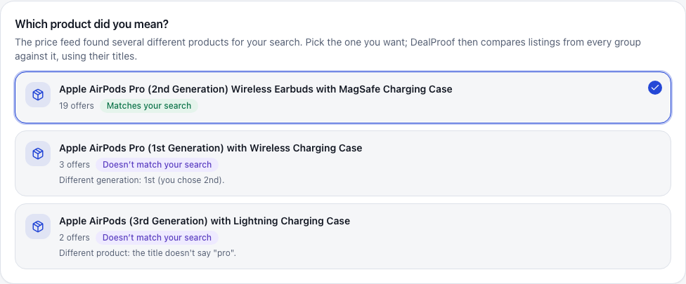
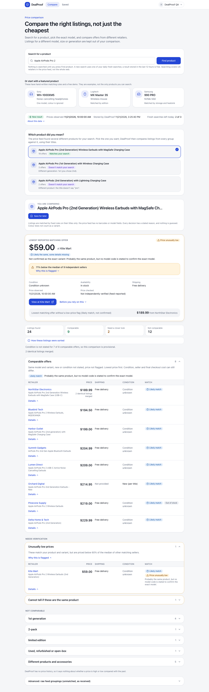
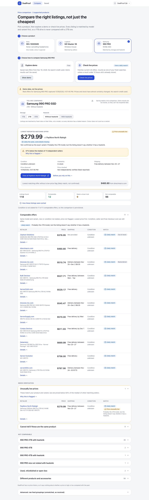
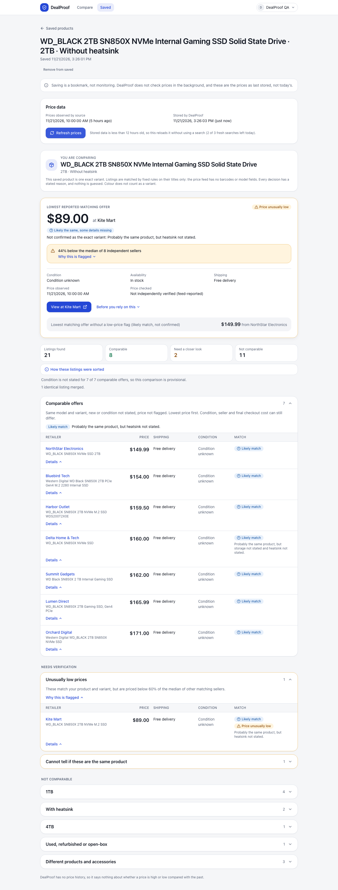
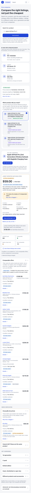
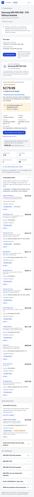

# DealProof

**Compare prices without comparing the wrong products.**

Live: **https://dealproof-review.app.space** (sign-in required) · Source: https://github.com/ModiCodie/dealproof-review (private)

DealProof takes a product search, lets you pick the product you mean, works out which retailer listings are really *that* product and variant, and shows the lowest reported price together with everything it cannot verify: condition, shipping, whether a price is real, and how old the data is. It is built on the [DeepSpace](https://docs.deep.space/) platform with the [PricesAPI](https://pricesapi.io/docs) price feed, as a five-day exercise.

## The problem

Price comparison mixes up variants: a 2TB drive with and without a heatsink, a charging case sold alone, a used unit, an accessory. The "lowest price" is then a price for something else. DealProof treats *"is this the same product?"* and *"is this price real?"* as separate questions and never merges them.

## What it does

- **Search any consumer product.** Free text → up to three product groups from PricesAPI → you pick the one you mean → a comparison of that group's listings. Typing one of three featured products (Sony WH-1000XM5, Logitech MX Master 3S, Samsung 990 PRO) uses that product's hand-written rules and a free demo.
- **Title-based, rule-based matching.** Each listing is classified *same model*, *likely the same*, *cannot tell*, *different variant* or *different product*, with a one-line reason. Deterministic rules, no LLM, no similarity score.
- **Conservative price summary.** For general products a lowest-price headline needs at least 3 independent sellers listing the item as **new** with no open configuration; otherwise the page says there is not enough to determine a reliable lowest price and shows what blocked it.
- **Honest unknowns.** Condition and shipping the feed does not provide stay "unknown". Every price says "Not independently verified". Defective, used, refurbished and incomplete listings are set apart.
- **Low-price warning** (below 60% of other independent sellers' median) is a rule of thumb, never an accusation.
- **Save and reopen.** A private list per user. A saved general comparison keeps the chosen product group and a **snapshot of the last successfully captured prices** (one group's listings, owner-only, deleted with the record). A failed or ambiguous refresh never replaces it and never switches to another product; the page shows when it was captured and that it is not today's price.
- **Demo vs live is always labelled.** Bundled samples are marked "Saved sample, not a live search" and cannot be saved.

## Screenshots

Taken by the automated tests against synthetic or bundled fixture data, **not live prices**.

| | |
|---|---|
|  Pick the product group |  Comparison with variants and caveats |
|  Featured-product demo |  Reopened saved comparison |
|  390 px |  390 px |

## Architecture

```
React pages (src/pages/(app)/(protected)/ search.tsx, saved/index.tsx, saved/[id].tsx)
   -> src/lib/api.ts   POST /api/actions/<name>   (Bearer JWT)
   -> worker.ts -> src/server/action-routes.ts    verifies the JWT (401 otherwise)
   -> src/actions/index.ts   searchProducts · getSavedComparison · captureSavedSnapshot · discardSavedSnapshot
        searchProducts -> src/server/pricing/search.ts   cache -> lock -> quota -> upstream -> store
           |- pricesapi.ts  the only code holding the API key and calling PricesAPI
           |- normalize.ts  validation + pure normalization (http(s) URLs only, missing fields stay null)
           |- quota.ts      atomic claims on usage_claims
        saved actions -> src/server/saved/  comparison.ts (reads cache/snapshot) · snapshot.ts (owner-checked capture)
   -> DeepSpace record Durable Object (SQLite):
        saved_products   owner-only, unique per user+product (client collection)
        search_cache, usage_claims, saved_snapshots   server-only (all client roles denied)

Matching and comparison run in the browser as pure TypeScript: src/lib/matching/
   families.ts (featured-product rules) · generic.ts (any product) · condition.ts · compare.ts · anomalies.ts
   src/lib/candidates.ts (groups -> choices) · src/lib/saved.ts, saved-candidate.ts (saved identity, snapshot use)
```

**Why the server owns the data:** the PricesAPI key lives only in the Worker (`env.PRICESAPI_KEY`). Prices in a snapshot are copied by the server from its own cache; the browser never supplies them. Every snapshot read, write and delete checks the verified caller against the owning saved record.

### DeepSpace primitives used

| Primitive | Used for |
|---|---|
| Authentication, JWT-verified actions | Sign-in gate; the server takes the user id from the token, never from parameters |
| Collections and permissions (`userBound`, `ownerField`, `own`, `uniqueOn`, immutable columns) | Owner-only saved products, duplicate prevention, closed server-only collections |
| `useQuery` / `useMutations` (`ready`, confirmed writes) | Live saved list; save and remove with server acknowledgement |
| Server actions | The only path to PricesAPI and to snapshots |
| Secrets store | `PRICESAPI_KEY` |
| Test tooling | Test accounts, Playwright fixtures, two-account browser tests on real local record storage |

## Setup

Requires Node 22.15+ / 24 / 26 and npm 11.6+.

```bash
npm install
npx deepspace auth login        # browser sign-in
# store the PricesAPI key without echoing it or putting it in shell history:
read -s k && printf 'PRICESAPI_KEY=%s\n' "$k" | npx deepspace secrets upload - ; unset k
npx deepspace dev start         # http://localhost:5173
```

The local dev server loads the real key, so a *manual* uncached search costs PricesAPI credits (about 10 per search; the app limits users to 3 fresh searches a day and the app overall to 15).

## Testing

| Command | Purpose |
|---|---|
| `npm run test:unit` | Unit tests, no network or credits (326) |
| `npx deepspace test run all` | Unit tests plus all browser tests: 326 unit + 44 browser pass; prices are mocked and any request to pricesapi.io fails a test |
| `npx tsc --noEmit` · `npx eslint .` · `npx vite build` | Types, lint, production build |
| `npx deepspace test run e2e` | Browser tests (needs two test accounts: `npx deepspace test accounts create --email <name>@deepspace.test --password-stdin`) |

10 browser tests are **opt-in** and skipped by default: screenshots (`DP_SHOTS=1`), replay of a locally captured real response (`DP_REPLAY=1`, needs a gitignored file), one live PricesAPI search (`DP_LIVE=1`, **spends credits**), and the two-phase snapshot lifecycle test (`DP_INTEGRATION=1`; it seeds the local cache with synthetic data via `tests/integration/local-cache.py` while the dev server is stopped, then exercises the real, unmocked snapshot actions on local record storage).

These are automated results on the local runtime. Production behaviour was verified separately, by hand, by the owner: see [`docs/production-release.md`](docs/production-release.md).

## Limitations

- **Titles are the only evidence.** PricesAPI returns no GTIN/UPC/MPN, brand or spec fields. A general match is therefore at best "likely"; only a model code in both the search and the title can give "same model", and a vague search (e.g. "cordless vacuum") is refused as insufficient identity.
- **Variants can stay unresolved.** If a title does not state capacity, generation or connector while other listings show the product comes in several, those listings are set aside as "configuration not stated", not guessed.
- **Unknown condition is never "new".** Condition is read from the title only; listings that do not state it are excluded from the price summary. Shipping and seller details are often missing.
- **Prices are feed-reported**, not checked at checkout, and there is no history; DealProof says nothing about whether a price is high or low over time.
- At most 3 product groups per paid search, US feed only, English-title heuristics. Some products will have no good candidate.
- The 60% low-price rule is a heuristic and sensitive near the line.
- **Snapshot scope.** Snapshots exist for general-search saves only; saves of the three featured products and older generic saves read the shared 12-hour cache. An unmatched refresh keeps the old snapshot rather than guessing. No monitoring or alerts.
- **Data retention is a judgement, not a clearance.** PricesAPI's terms do not specify a retention period, but also do not grant blanket rights to the underlying third-party content. The app keeps the minimum (one group per saved comparison, owner-only, deleted with the record, never redistributed). This is not legal advice.
- **Bundled sample data.** The three featured-product demos ship captured PricesAPI results (retailer titles, prices, URLs) as fixtures, which are also embedded in the public JavaScript bundle. See [`docs/production-release.md`](docs/production-release.md) for this open question.
- Tested in headless Chromium at desktop and 390 px; production checked by hand in the owner's browser only.

## Documentation

[`docs/production-release.md`](docs/production-release.md) (release history, production acceptance) · [`docs/general-search.md`](docs/general-search.md) (general search, matching, snapshots, release notes) · [`docs/submission-note.md`](docs/submission-note.md) · [`docs/live-coding-prep.md`](docs/live-coding-prep.md)

History (dated; each describes the state at the time): [`feasibility-plan`](docs/feasibility-plan.md) · [`api-experiment-results`](docs/api-experiment-results.md) · [`day2`](docs/day2-implementation.md) · [`day3`](docs/day3-implementation.md) · [`day4`](docs/day4-implementation.md) · [`final-audit`](docs/final-audit.md) · deployment: [`deployment-issue`](docs/deployment-issue.md), [`deployment-forensics`](docs/deployment-forensics.md), [`fresh-deployment-experiment`](docs/fresh-deployment-experiment.md)

**Agent setup.** The official DeepSpace agent skill is committed under `.claude/skills/deepspace/` and pinned in `skills-lock.json`; it is an operating guide and adds no runtime dependency.

License: none chosen (all rights reserved by default).
