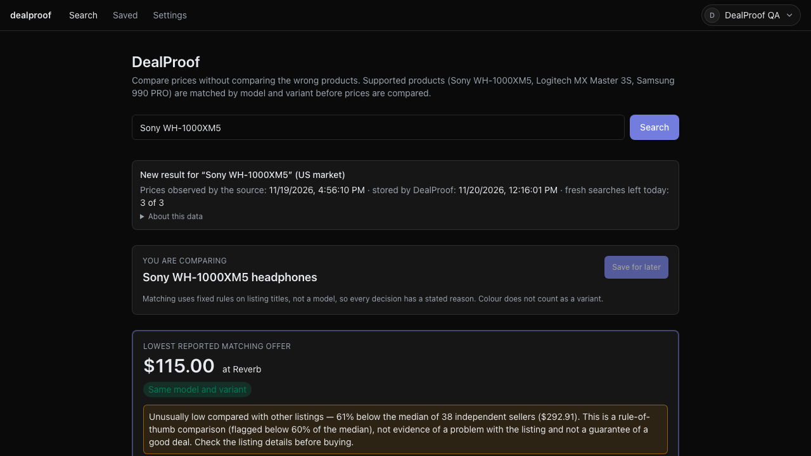
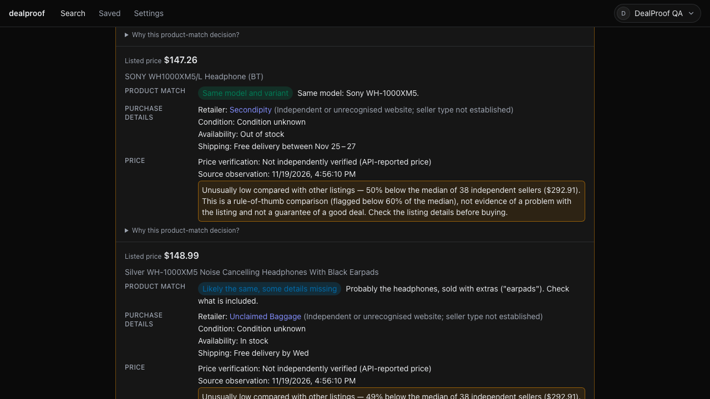
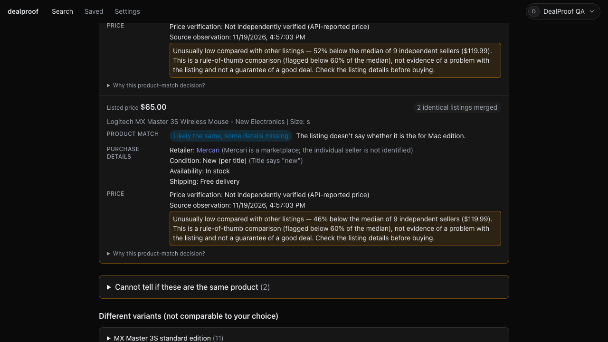
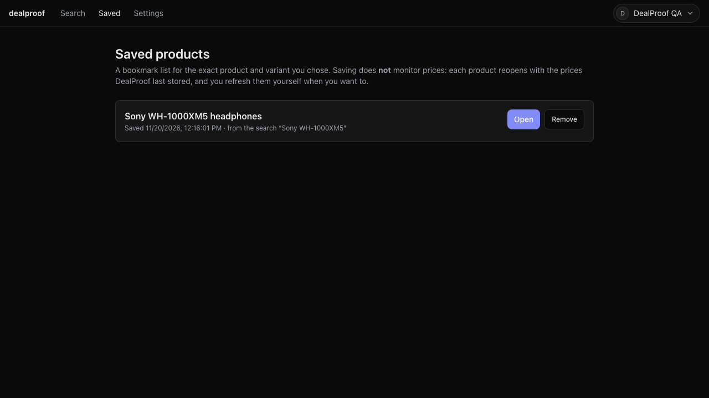
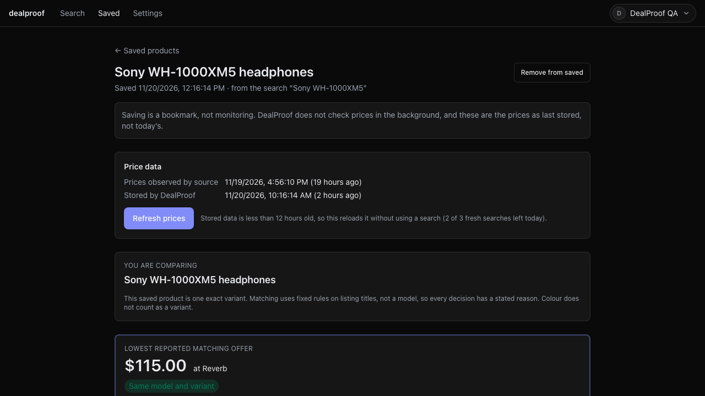
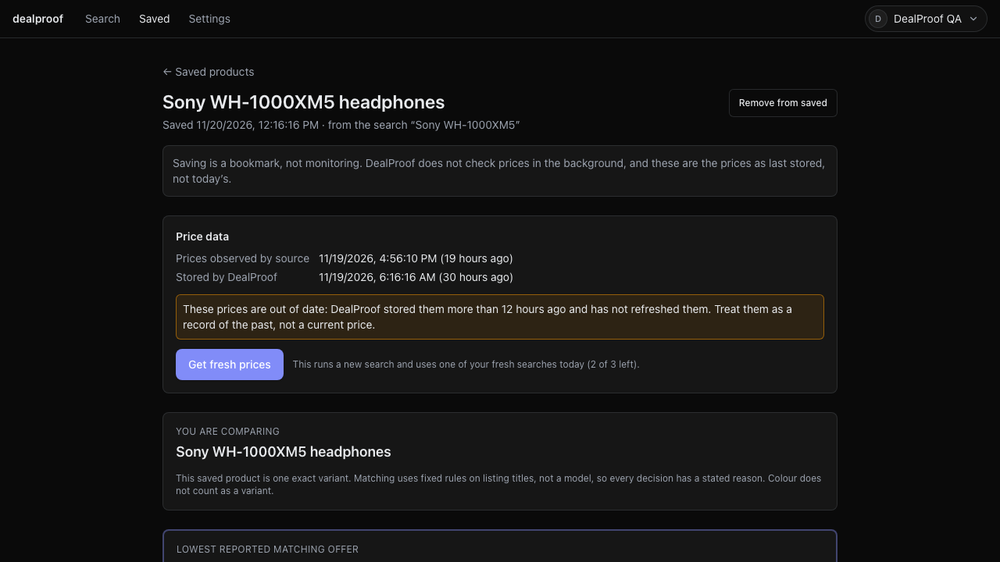
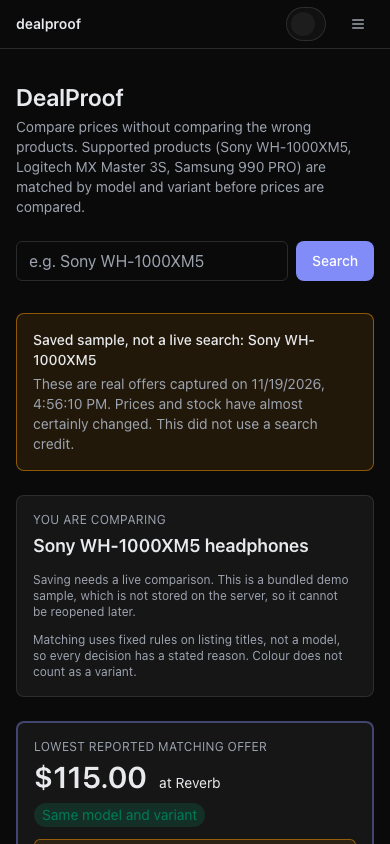
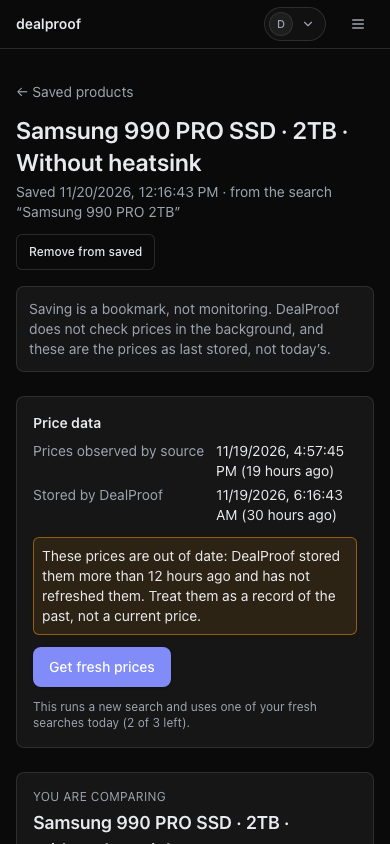

# DealProof

**Compare prices without comparing the wrong products.**

DealProof searches retailer offers for a product, works out which listings are really the *same model and variant* you chose, and shows the lowest reported price together with everything it cannot verify: condition, shipping, whether a price is real, and how old the data is. Built on the [DeepSpace](https://docs.deep.space/) platform with the [PricesAPI](https://pricesapi.io/docs) price feed. A five-day exercise; by design it supports three products (Sony WH-1000XM5, Logitech MX Master 3S, Samsung 990 PRO).

> **Deployment status: BLOCKED (platform side), not complete.** The local app is finished and tested. The first `deepspace deploy` left the app stuck in a release-reconciliation state: the control plane says "never deployed" (0 releases), while https://dealproof.app.space answers with an *older* build that does not contain the saved-products features. A bug report was submitted to DeepSpace (id `8d11d4c4-e418-40eb-9912-3348a9cef234`); there is no response yet. Nothing in this README has been verified on the live site. Details and evidence: [`docs/deployment-issue.md`](docs/deployment-issue.md).

## The problem

Price comparison sites mix up variants: a 2TB drive with and without a heatsink, a "for Mac" mouse, a used unit, a listing that is really an accessory. The "lowest price" is then a price for something else. DealProof treats *"is this the same product?"* as a separate question from *"is this price real?"* and never merges them.

## Main features

- **Search** a supported product; results come from PricesAPI, cached for 12 hours.
- **Variant-aware matching.** Choose storage size, heatsink or edition; each offer is classified *same model and variant*, *likely the same (details missing)*, *cannot tell*, *different variant* or *different product*, with a one-line reason and the evidence.
- **Lowest reported matching offer**, never "best deal": shown with match label, condition, availability, shipping, observation time and a retailer link.
- **Low-price warning** ("Unusually low compared with other listings") when a price is below 60% of the median of other independent sellers. It is a rule of thumb, not an accusation, and not a guarantee of a good deal.
- **Honest unknowns.** Condition and shipping the feed does not provide stay "unknown" / "Not provided". Every price says "Not independently verified".
- **Save for later**, a private list that reopens the last stored comparison. Saving is a bookmark, not monitoring.
- **Two clocks.** "Prices observed by the source" and "stored by DealProof" are always shown separately; stale data is labelled and refreshed only on an explicit click.

## Screenshots

All screenshots use bundled or mocked saved data from 19 Nov 2026, **not live prices**.

| | |
|---|---|
|  Search result: lowest reported offer, match label, warning |  Flagged offers keep their unknown condition/shipping and "not verified" labels |
|  Variants grouped apart, likely matches labelled |  Saved list |
|  Reopened: both timestamps |  Stale data labelled, explicit refresh |
|  390 px |  390 px |

## Demo walkthrough (about 3 minutes, no search credits)

Use the **saved sample** buttons on the search page (real results captured 19 Nov 2026, labelled "Saved sample, not a live search"):

1. **Search / variants.** Load *Samsung 990 PRO 2TB*. Switch Storage to 4TB and Heatsink to "With heatsink": offers regroup, and other variants move to "Different variants (not comparable)". 4TB shows *Insufficient evidence* instead of a verdict.
2. **Flagged price.** Load *Sony WH-1000XM5*. The headline shows the lowest reported offer with an amber "Unusually low compared with other listings" note and a reference line with the lowest unflagged offer.
3. **Unknowns.** In any offer card: "Condition unknown", "Shipping: Not provided", "Not independently verified".
4. **Likely vs exact.** In the Samsung 2TB view the headline is a *likely* match and says "Not confirmed as the exact variant".
5. **Save / reopen.** Samples cannot be saved (they are not stored server-side). With a live (or cached) search, choose **Save for later**, open **Saved**, reopen it: you get the stored comparison, both timestamps, and a **Refresh** button that says whether it will spend a search.

## Architecture

```
React page (src/pages/(app)/(protected)/search.tsx)
   -> src/lib/api.ts  POST /api/actions/searchProducts  (Bearer JWT)
   -> worker.ts -> src/server/action-routes.ts   verifies the JWT (401 otherwise)
   -> src/actions/index.ts  searchProducts
   -> src/server/pricing/search.ts   cache -> lock -> quota -> upstream -> store
        |- pricesapi.ts   the only code that holds the API key and calls PricesAPI
        |- normalize.ts   validation + pure response normalization
        |- quota.ts       atomic claims on the usage_claims collection
   -> DeepSpace record Durable Object (SQLite): search_cache, usage_claims, saved_products

Matching (pure TypeScript, browser): src/lib/matching/  families.ts (rules) · compare.ts · anomalies.ts

Saved products:
   pages saved/index.tsx, saved/[id].tsx -> useQuery/useMutations on `saved_products` (owner-only, enforced by the DO)
   -> POST /api/actions/getSavedComparison -> src/server/saved/comparison.ts   (reads search_cache only; no upstream, no quota)
```

## DeepSpace primitives used

| Primitive | Used for |
|---|---|
| Authentication (`AuthGate`, JWT on actions) | Sign-in required for search and saved pages; the server derives the user id from the verified token |
| Collections and permissions (`userBound`, `ownerField`, `own`, `uniqueOn`, `immutable`) | Owner-only saved products, duplicate prevention, closed server-only cache and quota collections |
| `useQuery` / `useMutations` | Live saved list, save and remove with server acknowledgement |
| Server actions | `searchProducts` (the only path to PricesAPI) and `getSavedComparison` |
| Secrets store | `PRICESAPI_KEY`, read only as `env.PRICESAPI_KEY` inside the Worker |
| Test tooling (`deepspace test`, test accounts, Playwright fixtures) | Two-account browser tests against real local record storage |

## PricesAPI integration

One call per uncached search (`Search` endpoint), never retried, 90 s timeout. The response is validated and normalized (`normalize.ts`); only http(s) URLs are kept; missing fields stay `null`. The Search endpoint gives no per-offer condition or timestamp, which is why those are "unknown". The key never reaches the browser or the repo.

## Matching and anomaly logic

- **Matching** is fixed regular-expression rules over normalized titles per product family (`families.ts`). Only two manufacturer-verified Samsung part numbers are used. Safety rules: several models in one title, or a part number contradicting the words, give "cannot tell"; accessory wording is rejected. Condition is read from the title only; the default is unknown. Details: [`docs/day3-implementation.md`](docs/day3-implementation.md).
- **Anomaly flag** (`anomalies.ts`): one price per independent seller, median of those, flag if price/median < 0.6. At least 6 independent sellers are needed, otherwise "Insufficient evidence". Exact matches form the baseline; likely matches are added only if exact ones are too few. A flag never removes an offer from the headline; it adds a visible warning.
- **Verification is separate:** no mechanism ties checking evidence to an offer, so every price is "Not independently verified".

## Why these choices

| Choice | Reason |
|---|---|
| Deterministic matching, not an LLM | Every decision has a stated, testable reason; no hallucinated equivalence, no per-query model cost, same input gives the same output |
| Native DeepSpace records for saved products | Ownership, uniqueness and read isolation are enforced by the platform and verified with two accounts; no custom database to build or secure |
| Native auth and secrets | No password or key handling in app code; the API key stays server-side |
| App-level cache and quotas | The free PricesAPI allowance is small; a shared 12-hour cache, per-user (3/day) and global (15/day) atomic limits protect it |
| No price history, predictions or alerts | The data source gives a snapshot only; inventing trends would be unsupported. Saving is deliberately not monitoring |

## Local setup and testing

Requires Node 22.15+ / 24 / 26 and npm 11.6+ (odd Node versions such as 25 are rejected by the scaffolder).

```bash
npm install
npx deepspace auth login                 # browser sign-in
# store the PricesAPI key without echoing it or putting it in shell history:
read -s k && printf 'PRICESAPI_KEY=%s\n' "$k" | npx deepspace secrets upload - ; unset k
npx deepspace dev start                  # http://localhost:5173
```

| Command | Purpose |
|---|---|
| `npm run test:unit` | 181 unit tests (no network, no API credits) |
| `npx deepspace test run all` | The unit tests plus all 31 browser tests in one run (documented full suite; prices mocked, no credits) |
| `npm run type-check` / `npm run lint` / `npm run build` | TypeScript, ESLint, production build |
| `npx deepspace test run e2e` | 31 browser tests. Needs two test accounts (`npx deepspace test accounts create --email <name>@deepspace.test --password-stdin`). Prices are mocked, so **no PricesAPI credits are used**; any request to pricesapi.io fails a test |
| `npx deepspace deploy` | Deploy to `<name>.app.space` (currently blocked, see above) |

**Agent setup.** The official DeepSpace agent skill is committed under `.claude/skills/deepspace/` and pinned in `skills-lock.json` (upstream `deepdotspace/deepspace-skill`, commit `dadfa915`). Claude Code loads it in a fresh session; it is only an operating guide and adds no runtime dependency.

Note: the local dev server loads the real `PRICESAPI_KEY` from `.dev.vars`, so a *manual* uncached search in dev costs a credit.

## Known limitations

- Three products only; matching reads titles only, so a wrong or vague title can mislead it.
- Prices are feed-reported and never independently verified; condition and shipping are mostly unknown.
- The 60% rule is a heuristic, sensitive near the line (one Best Buy offer sits at 58%).
- A saved product reopens with the latest data stored for its search, not a snapshot of what you saw.
- Demo samples cannot be saved.
- Tested in headless Chromium at desktop and 390 px only; not on other browsers, tablets or screen readers.
- **Not deployed**: production verification (live auth, actions, saved-product persistence) has not been done.

## Documentation

[`docs/feasibility-plan.md`](docs/feasibility-plan.md) · [`docs/api-experiment-results.md`](docs/api-experiment-results.md) · [`docs/day2-implementation.md`](docs/day2-implementation.md) · [`docs/day3-implementation.md`](docs/day3-implementation.md) · [`docs/day4-implementation.md`](docs/day4-implementation.md) · [`docs/deployment-issue.md`](docs/deployment-issue.md) · [`docs/submission-note.md`](docs/submission-note.md) · [`docs/live-coding-prep.md`](docs/live-coding-prep.md)

License: not yet chosen (see the repository owner).
